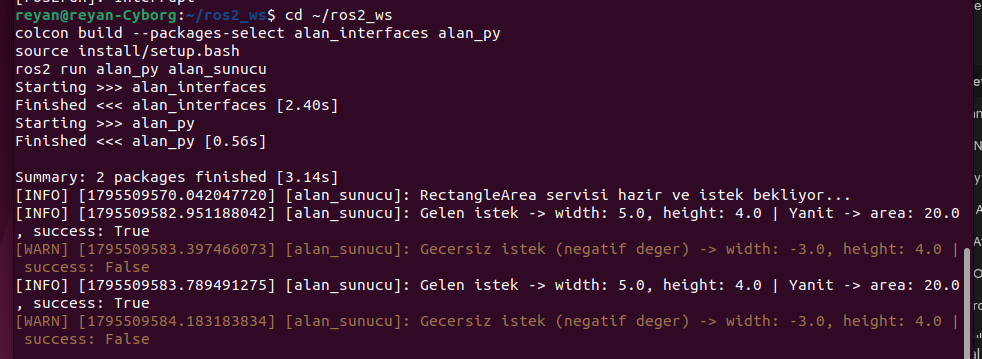
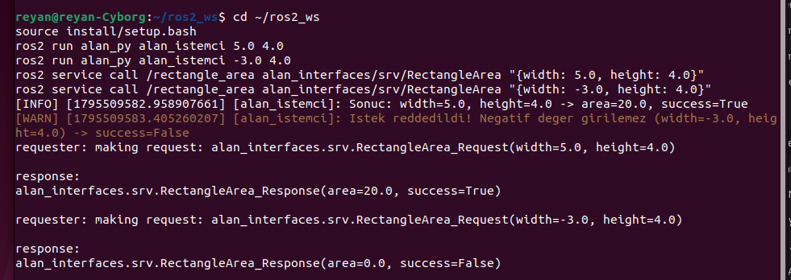

# ROS 2 Humble - RectangleArea Servisi

Bu depo, ROS 2 Humble üzerinde özel servis arayüzü (`RectangleArea.srv`) kullanarak dikdörtgen alanı hesaplayan sunucu ve istemci paketlerini (`alan_interfaces` ve `alan_py`) içerir. Negatif değerler `bool success` alanı ile reddedilmektedir.

## Derleme ve Kurulum

```bash
cd ~/ros2_ws
colcon build --packages-select alan_interfaces alan_py
source install/setup.bash
```

## Çalıştırma Komutları

**1. Terminal (Sunucu):**
```bash
ros2 run alan_py alan_sunucu
```

**2. Terminal (İstemci - Geçerli ve Negatif Değer Testi):**
```bash
ros2 run alan_py alan_istemci 5.0 4.0
ros2 run alan_py alan_istemci -3.0 4.0
```

## `ros2 service call` Doğrulama ve Çıktıları

**Geçerli istek:**
```bash
ros2 service call /rectangle_area alan_interfaces/srv/RectangleArea "{width: 5.0, height: 4.0}"
```

Çıktı:
```text
requester: making request: alan_interfaces.srv.RectangleArea_Request(width=5.0, height=4.0)

response:
alan_interfaces.srv.RectangleArea_Response(area=20.0, success=True)
```

**Negatif değer testi (Bonus):**
```bash
ros2 service call /rectangle_area alan_interfaces/srv/RectangleArea "{width: -3.0, height: 4.0}"
```

Çıktı:
```text
requester: making request: alan_interfaces.srv.RectangleArea_Request(width=-3.0, height=4.0)

response:
alan_interfaces.srv.RectangleArea_Response(area=0.0, success=False)
```

## Terminal Ekran Görüntüleri

### Sunucu Çıktısı


### İstemci ve Servis Çağrısı Çıktısı
